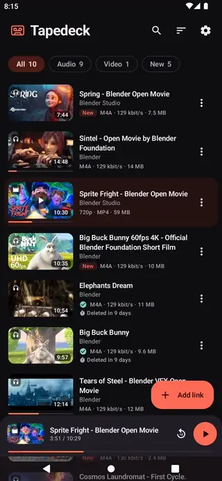
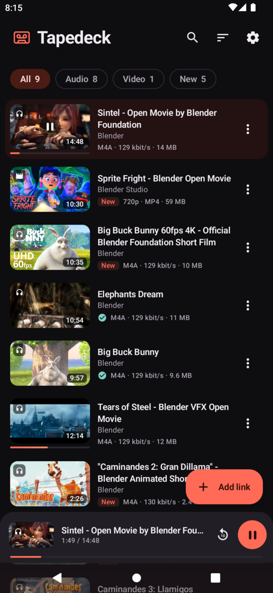
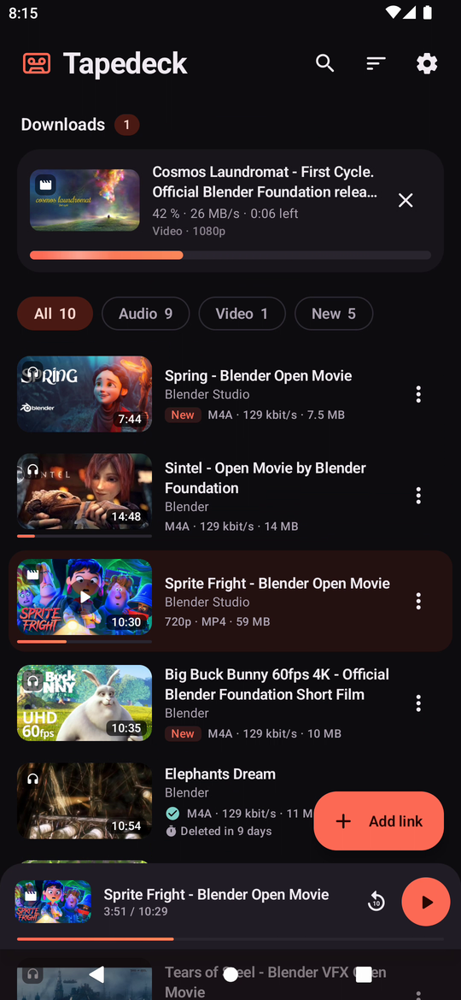
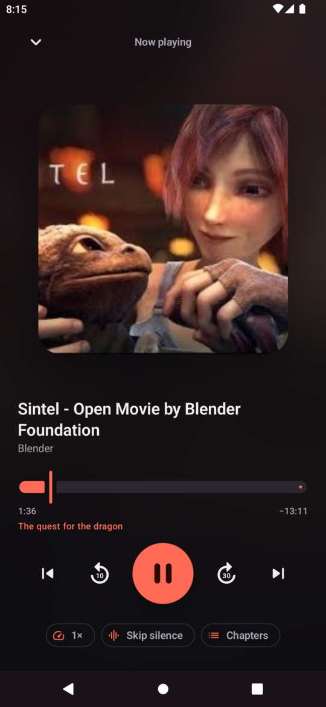
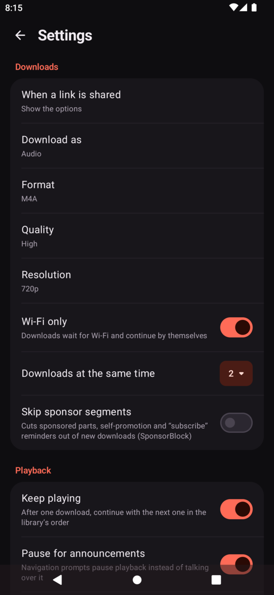
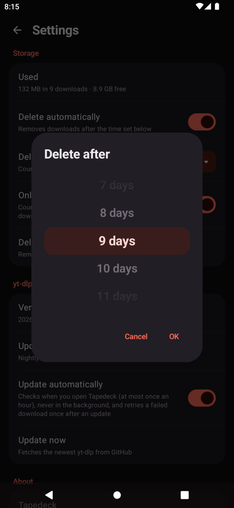

<div align="center">


# Tapedeck

### Your tape deck for the road.

Share a YouTube video, get it as audio — or video — on your phone, and listen offline:
with the screen off, through the car stereo or Android Auto, and always from where you stopped.

<p>
  <a href="https://github.com/DevEmperor/Tapedeck/releases/latest"></a>
  <a href="https://github.com/DevEmperor/Tapedeck/releases"></a>
  <a href="LICENSE"></a>
  
  <a href="https://github.com/sponsors/DevEmperor"></a>
  <a href="https://github.com/DevEmperor/Tapedeck/stargazers"></a>
</p>

<p>
  
  
  
  
  
</p>

<table align="center">
  <tr>
    <td valign="middle"><a href="https://github.com/DevEmperor/Tapedeck/releases/latest"></a></td>
    <td valign="middle"><a href="https://paypal.me/DevEmperor"></a></td>
  </tr>
</table>

</div>

---

## 🎬 See it in action

<table>
  <tr>
    <td width="330" align="center">
      
    </td>
    <td valign="middle">
      <h3>Share. Download. Drive.</h3>
      Tap <b>Share</b> in the YouTube app and pick <b>Tapedeck</b>. A sheet shows the video's title and
      picture; choose audio or video, the format and the quality — Tapedeck remembers your choice — and
      tap <b>Download</b>.
      <br><br>
      The download runs in the background with a live progress bar, even with the screen off. A minute
      later it is in your library, ready for the drive: no ads, no buffering in a tunnel, no data used on
      the road.
    </td>
  </tr>
</table>

<br>

## 📸 Screenshots

<table>
  <tr>
    <td align="center"></td>
    <td align="center"></td>
    <td align="center"></td>
    <td align="center"></td>
  </tr>
  <tr>
    <td align="center"></td>
    <td align="center"></td>
    <td align="center"></td>
    <td align="center"></td>
  </tr>
</table>

<br>

## ✨ Features

### Downloading

- **Share and done.** Share a link from the YouTube app (or any of the
  [sites yt-dlp supports](https://github.com/yt-dlp/yt-dlp/blob/master/supportedsites.md)), or paste one.
  Tracking parameters are stripped, timestamps kept.
- **Audio the way you need it.** **M4A** is YouTube's own AAC sound, saved without re-encoding; **MP3**
  is for car stereos that play USB sticks; **Original** keeps the stream as it is (mostly Opus).
  *High* quality, or *Data saver* at about 64 kbit/s — plenty for talks and podcasts.
- **Video** in 360p to 1080p, preferring H.264 so every phone plays it smoothly.
- **Whole playlists** in one go: share a playlist and get every video, in order.
- **A real download manager.** A queue with 1–5 downloads at a time, a progress bar with speed and time
  left, a notification, and readable errors (unavailable, private, age-restricted, no space, …).
- **Wi-Fi only**, on by default: downloads wait for Wi-Fi and continue by themselves, picking up where
  they stopped.
- **SponsorBlock**, optional: cuts sponsored parts, self-promotion and "subscribe" reminders out of new
  downloads.

### yt-dlp that keeps working

- [yt-dlp](https://github.com/yt-dlp/yt-dlp) runs on the phone with its own Python, FFmpeg and QuickJS
  (the JavaScript runtime YouTube's player needs), thanks to
  [youtubedl-android](https://github.com/yausername/youtubedl-android).
- **Updated when you open the app** — from the nightly channel by default, where YouTube fixes land
  first; at most once an hour and never in the background.
- When YouTube refuses a download or changes something, Tapedeck tries again by itself and fetches a
  newer yt-dlp first.

### Made for the car

- **Plays with the screen off** and keeps playing when you switch apps.
- **Steering wheel, headset and lock screen** control it; the notification has **−10 s / +30 s**.
- **Remembers where you stopped** in every download and resumes a few seconds earlier, so you don't lose
  the thread.
- **The car's play button resumes the last download**, even after Android closed the app.
- **Pauses for navigation announcements** instead of talking over them.
- **Keeps playing** the next download in the library's order — sort *oldest first* for a lecture series.
- **Android Auto** shows *Continue*, *New* and *All downloads*.
- Speed from 0.75× to 2×, **skip silence**, **chapters**, and full-screen video for when you are parked.

### Keeping your phone tidy

- Library with search, filters (audio, video, new) and sorting; *new* and *heard* at a glance.
- Delete with undo, **keep** a download to protect it, or delete everything heard.
- **Automatic clean-up** after 1–90 days, counted from the download or from when you heard it to the end.
- **Save to Downloads** to copy a file to a USB stick, or share it.

### Updates without a store

- Tapedeck asks GitHub for a new release when you open it. **Install** downloads the APK for your
  phone's processor, checks it against GitHub's SHA-256 checksum, and hands it to Android's installer —
  no browser, no file hunting.

<br>

## 📲 Installation

Tapedeck is **not on Google Play** — Play does not allow apps that download from YouTube. Get it from the
[**latest release**](https://github.com/DevEmperor/Tapedeck/releases/latest):

| File | For |
|---|---|
| `tapedeck-<version>-universal.apk` (~200 MB) | **Any phone.** Pick this one if you are unsure. |
| `tapedeck-<version>-arm64-v8a.apk` (~57 MB) | Almost every phone of the last years |
| `tapedeck-<version>-armeabi-v7a.apk` (~50 MB) | Older 32-bit phones |
| `tapedeck-<version>-x86_64.apk` / `-x86.apk` | Emulators, Chromebooks, a few tablets |

The per-processor APKs carry only one copy of Python, FFmpeg and QuickJS and are much smaller. All are
signed with the same key, so later updates install over any of them.

**Good to know**

- Android asks once whether your browser — and later Tapedeck itself, for its updates — may install apps.
- **Google Play Protect** may suggest scanning an app it has not seen before. Choose *Scan app*, then
  *Install*.
- The first start unpacks Python and FFmpeg and fetches the current yt-dlp; give it a few seconds.
- Preparing a YouTube download takes 15–40 seconds (the phone solves YouTube's JavaScript challenge);
  the download itself is fast.
- **Samsung:** set Tapedeck's battery use to *Unrestricted* so nothing is paused in the background.
- **Android Auto** lists apps that do not come from Play only after turning on *Unknown sources* in
  Android Auto's developer settings.

<br>

## 🔒 Privacy

Tapedeck has no account, no analytics and no ads. It connects only to:

- **YouTube** (or the site you shared), through yt-dlp, to download what you asked for, and YouTube's
  oEmbed endpoint for the title and picture in the download sheet;
- **GitHub**, to check for and download updates of yt-dlp and of Tapedeck;
- **SponsorBlock**, only if *Skip sponsor segments* is on (yt-dlp sends a short hash prefix of the
  video id).

Downloads stay in the app's own folder on your phone until you or the clean-up delete them.

<br>

## 🛠 Building

Requires JDK 21 and the Android SDK (compileSdk 37).

```bash
./gradlew :app:assembleDebug -Ptapedeck.abis=arm64-v8a   # one processor, for your phone
./gradlew :app:assembleRelease                           # universal + one APK per processor
./gradlew :app:testDebugUnitTest
```

Release builds are signed with the key from an untracked `keystore.properties` (`storeFile`,
`storePassword`, `keyAlias`, `keyPassword`), or with the debug key if it is missing.

<br>

## ⚖️ Please note

Only download what you may keep — your own videos, freely licensed content, or a private copy where
your law allows it. YouTube's terms of service restrict downloading. The screenshots show
[Blender Studio's open movies](https://studio.blender.org/films/) (CC BY).

## 📄 License

Tapedeck is free software under the [GNU General Public License v3.0](LICENSE) or later.
It bundles yt-dlp (Unlicense), youtubedl-android (GPL-3.0), Python (PSF), FFmpeg (GPL), QuickJS (MIT),
AndroidX Media3, Coil and OkHttp (Apache-2.0).

Questions or ideas? [Open an issue](https://github.com/DevEmperor/Tapedeck/issues) or write to
contact@devemperor.net.
