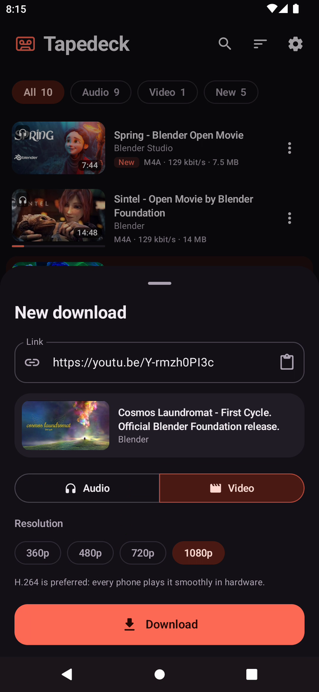
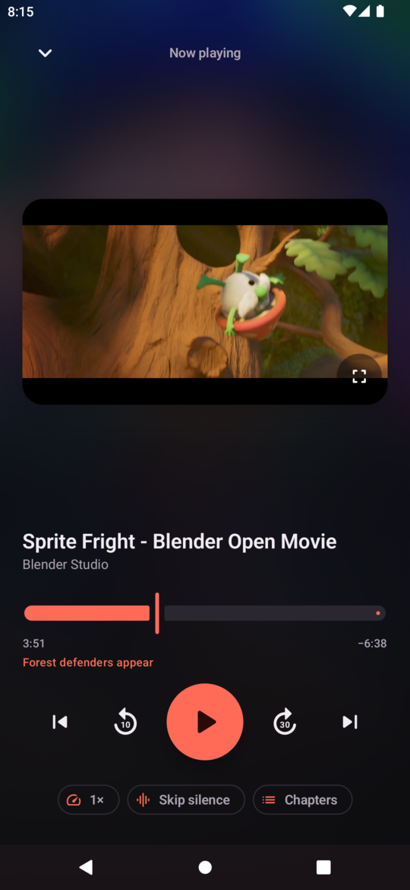
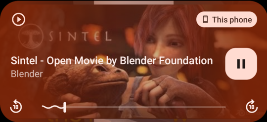
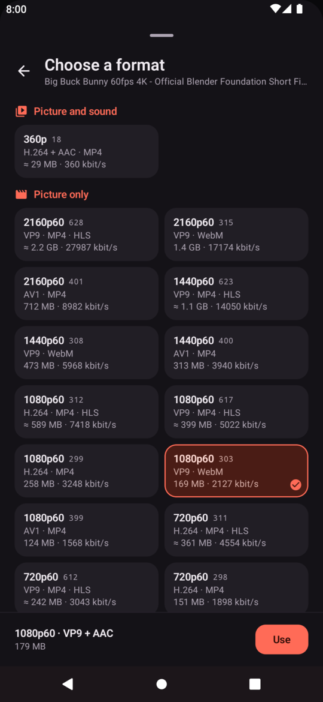
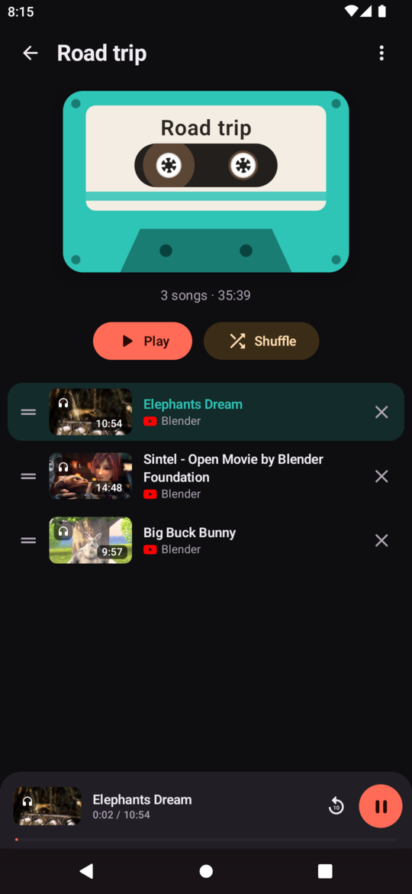
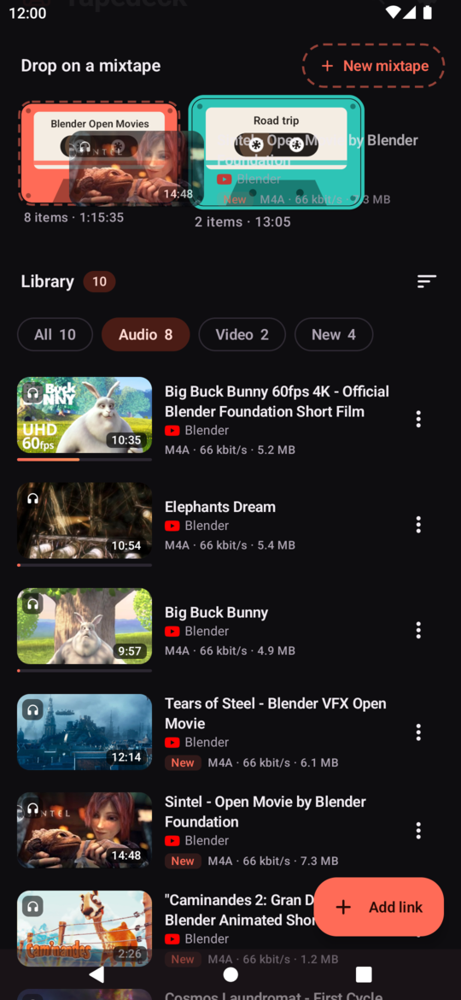
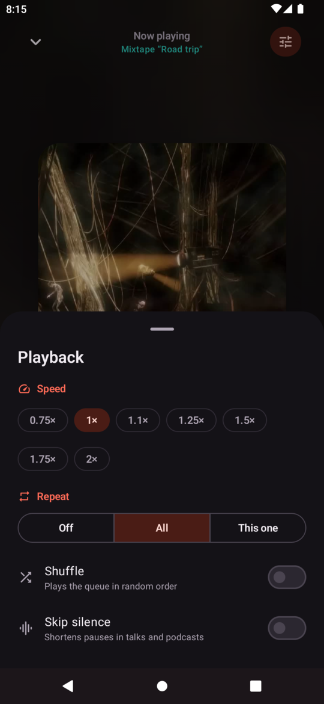
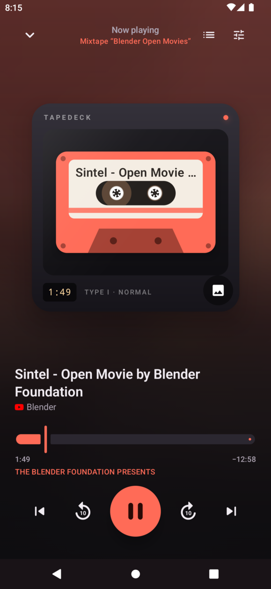
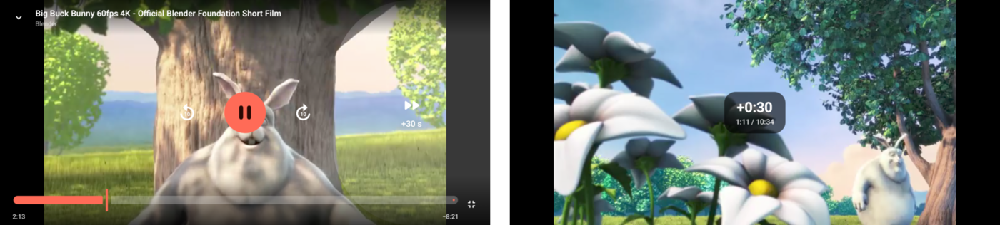

<div align="center">


# Tapedeck

### Your tape deck for the road.

Share a video from YouTube, Instagram, TikTok & Co., get it as audio — or video — on your phone, and
listen offline: with the screen off, through the car stereo or Android Auto, and always from where you
stopped.

<p>
  <a href="https://github.com/DevEmperor/Tapedeck/releases/latest"></a>
  <a href="https://github.com/DevEmperor/Tapedeck/releases"></a>
  <a href="LICENSE"></a>
  
  <a href="https://github.com/sponsors/DevEmperor"></a>
  <a href="https://github.com/DevEmperor/Tapedeck/stargazers"></a>
</p>

<p>
  
  
  
  
  
</p>

<table align="center">
  <tr>
    <td valign="middle"><a href="https://github.com/DevEmperor/Tapedeck/releases/latest"></a></td>
    <td valign="middle"><a href="https://paypal.me/DevEmperor"></a></td>
  </tr>
</table>

</div>

---

## 🎬 See it in action

<table>
  <tr>
    <td width="330" align="center">
      
    </td>
    <td valign="middle">
      <h3>Share. Download. Drive.</h3>
      Tap <b>Share</b> in the YouTube app and pick <b>Tapedeck</b>. A sheet shows the video's title and
      picture; choose audio or video, the format and the quality — Tapedeck remembers your choice — and
      tap <b>Download</b>.
      <br><br>
      The download runs in the background with a live progress bar, even with the screen off. A minute
      later it is in your library, ready for the drive: no ads, no buffering in a tunnel, no data used on
      the road.
    </td>
  </tr>
</table>

<br>

## 📸 Screenshots

<table>
  <tr>
    <td align="center"></td>
    <td align="center"></td>
    <td align="center"></td>
    <td align="center"></td>
  </tr>
  <tr>
    <td align="center"></td>
    <td align="center"></td>
    <td align="center"></td>
    <td align="center"></td>
  </tr>
  <tr>
    <td align="center"></td>
    <td align="center"></td>
    <td align="center"></td>
    <td align="center"></td>
  </tr>
</table>

<br>

## ✨ Features

### Downloading

- **Share and done.** Share a link from YouTube, Instagram, TikTok, X, Facebook, Reddit, SoundCloud,
  Bandcamp, Dailymotion, the ARD/ZDF/arte Mediatheken — or any other of the
  [sites yt-dlp supports](https://github.com/yt-dlp/yt-dlp/blob/master/supportedsites.md) — or paste one.
  Tracking parameters (`si`, `igsh`, `utm_*`, TikTok's and X's share tokens …) are stripped, timestamps
  kept.
- **Title and picture first.** YouTube answers instantly; for other sites yt-dlp reads them while you
  choose — and if a site wants a login (Instagram often does for anything not public), Tapedeck says so
  before you download. Tapedeck has no logins or cookies, so it loads public posts only.
- **Copied a link?** Open Tapedeck and it offers a link of a known video site from your clipboard — and
  tells you if that video is already in your library.
- **Audio the way you need it.** **M4A** is AAC, on YouTube saved without re-encoding; **MP3** is for car
  stereos that play USB sticks; **Original** keeps the stream as it is (on YouTube mostly Opus).
  *High* quality, or *Data saver* at about 64 kbit/s — plenty for talks and podcasts.
- **Video** in 360p to 1080p as **MP4** (H.264 + AAC, which every phone plays smoothly), **WebM**
  (VP9 + Opus, smaller) or **MKV** (the best picture in any codec, often AV1).
- **Or pick the exact stream**, like `yt-dlp -F`: *Custom…* lists every format as a card with resolution,
  frame rate, HDR, codecs, size and bitrate — picture with sound, picture only, sound only. A picture-only
  stream gets the best sound to go with it, which you can change; the sheet shows the total size.
- Audio and video have **their own defaults** in the settings; the sheet remembers whether you last chose
  audio or video.
- **Whole playlists** in one go: share a playlist and get every video, in order.
- **A real download manager.** A queue with 1–5 downloads at a time, a progress bar with speed and time
  left — for a video it says whether the picture or the sound is coming in, and the bar weighs both by
  their real sizes — a notification, and readable errors (unavailable, private, age-restricted, no
  space, …).
- **Wi-Fi only**, on by default: downloads wait for Wi-Fi and continue by themselves, picking up where
  they stopped. Need one now anyway? *Use mobile data* on its card (or for all waiting ones, or right in
  the notification) lets it go ahead — and on mobile data, the download sheet offers the same switch.
- **SponsorBlock**, optional: cuts sponsored parts, self-promotion and "subscribe" reminders out of new
  downloads.

### yt-dlp that keeps working

- [yt-dlp](https://github.com/yt-dlp/yt-dlp) runs on the phone with its own Python, FFmpeg and QuickJS
  (the JavaScript runtime YouTube's player needs), thanks to
  [youtubedl-android](https://github.com/yausername/youtubedl-android).
- **Faster preparation with [QuickJS-NG](https://github.com/quickjs-ng/quickjs)**, which solves YouTube's
  JavaScript challenge about 28 % faster than the bundled QuickJS (3.7 s instead of 5.1 s per video on the
  test emulator). Tapedeck checks once that it runs on your phone and falls back to QuickJS otherwise.
- **Updated when you open the app** — from the nightly channel by default, where YouTube fixes land
  first; at most once an hour and never in the background.
- When YouTube refuses a download or changes something, Tapedeck tries again by itself and fetches a
  newer yt-dlp first.

### Made for the car

- **Plays with the screen off** and keeps playing when you switch apps.
- **Steering wheel, headset and lock screen** control it; the notification has **−10 s / +10 s**.
- **Remembers where you stopped** in every download and resumes a few seconds earlier, so you don't lose
  the thread.
- **The car's play button resumes the last download**, even after Android closed the app.
- **Pauses for navigation announcements** instead of talking over them.
- **Keeps playing** the next download in the library's order — sort *oldest first* for a lecture series.
- **Android Auto** shows *Continue*, *Mixtapes*, *New* and *All downloads*.
- One **playback menu** at the top of the player: speed from 0.75× to 2×, **repeat** (all or this one),
  **shuffle** and **skip silence**; it lights up when something differs from the usual.
- **Chapters**, and full-screen video with its own controls for when you are parked.
- **Full screen with gestures**: double tap left or right for −10 / +10 s (keep tapping for more), or
  press and slide sideways to scrub — both show how far you jump. A double tap on the video, or on the
  mini player, goes straight to full screen.
- **Turn the phone** sideways and a landscape video goes full screen; hold it upright again and you are
  back in the player (with *Auto-rotate* on, as in other video apps).
- **Upright videos stay upright**: a reel or Short fills the player in its own shape, and its full
  screen is upright too.
- **Swipe Tapedeck away** in the recent apps and everything stops — playback and downloads. Unfinished
  downloads continue from where they were the next time you open it.

<p align="center"></p>

### Mixtapes

- **Your own playlists, as cassettes.** Put downloads on mixtapes — music for the drive, a lecture
  series, the kids' favourites. They sit on a shelf above the library, each in its own colour, and their
  reels turn while one of them plays.
- **One after the other**: *Play* runs a mixtape in its order (and turns into *Pause* / *Resume* while
  it plays), *Shuffle* mixes it, and with *Repeat* it starts over. Drag an item by its handle to move it;
  a download can be on several mixtapes.
- **Drag onto a mixtape**: press and hold a card in the library — a small copy of it lifts off and
  hangs right under your finger, while the card stays marked — and the shelf comes into view, every
  cassette waiting with a dashed ring; drop it right on one (it grows and its reels turn when you are
  over it) or on *New mixtape* in the shelf's head. Hold it near the shelf's edge to reach the
  cassettes further along; the list then goes back to where you were.
- Before the first mixtape, the shelf shows an empty cassette: tap it to start one, or drop a download on
  it.
- **Straight onto a mixtape** when downloading — and a whole YouTube playlist can become a new mixtape
  of its own name, in the playlist's order.
- What is on a mixtape is never removed by the automatic clean-up (a setting, on by default). Deleting a
  mixtape keeps its downloads.
- In **Android Auto**, every mixtape is a folder; picking an item plays the mixtape from there.

### A tape deck to look at

- **Reels that turn** on the shelf while a mixtape plays — faster at 1.5× — starting up and running down
  like a real deck.
- **Cassette deck**: tap the cover in the player (or the small cassette button on it) and audio plays as a
  cassette behind the smoked-glass door of a deck, with a tape counter and a play light. Scrub the seek
  bar and the reels spool fast forward or back; crossing into another chapter ticks under your finger.
- **Downloads as tape** running from one reel onto the other; when one is done, its card slides down into
  the library, turns into a library card and lights up for a moment, with a click to feel.
- **Covers travel**: tap a video in the list or the mini player and its picture grows into the player;
  a cassette on the shelf flies to the top of its mixtape — and back.
- **The colour of what plays**: the player takes the cover's colour (or the mixtape's), and so does the
  cassette in the deck.
- On the very first start, the empty rack's cassette turns while Python and yt-dlp get ready.

### Keeping your phone tidy

- Clear sections — *Downloads*, *Mixtapes*, *Library* — with the library's sorting and filters (audio,
  video, new) in its own head; search; *new* and *heard* at a glance; a steady scrollbar (it keeps the
  height of every row it has seen, instead of guessing) to jump through long lists.
- **Where is it from?** The logo of YouTube, Instagram, TikTok, X, Facebook, Reddit, SoundCloud, Vimeo,
  Twitch, Dailymotion, Bandcamp, Bilibili and a few more sits next to the channel name.
- Delete with undo, **keep** a download to protect it, or delete everything heard.
- **Automatic clean-up** after 1–90 days, counted from the download or from when you heard it to the end.
- **Save to Downloads** to copy a file to a USB stick, or share it — both named after the video's
  title, not `media.mp4`.

### Updates without a store

- Tapedeck asks GitHub for a new release when you open it — also when you come back to it after it
  sat in the background. **Install** downloads the APK for your
  phone's processor, checks it against GitHub's SHA-256 checksum, and hands it to Android's installer —
  no browser, no file hunting. Once Android is done, the library says so where the banner was.
- In the settings, **Update** sits right next to the yt-dlp version and **Check** next to Tapedeck's.

<br>

## 📲 Installation

Tapedeck is **not on Google Play** — Play does not allow apps that download from YouTube. Get it from the
[**latest release**](https://github.com/DevEmperor/Tapedeck/releases/latest):

| File | For |
|---|---|
| `tapedeck-<version>-universal.apk` (~200 MB) | **Any phone.** Pick this one if you are unsure. |
| `tapedeck-<version>-arm64-v8a.apk` (~57 MB) | Almost every phone of the last years |
| `tapedeck-<version>-armeabi-v7a.apk` (~50 MB) | Older 32-bit phones |
| `tapedeck-<version>-x86_64.apk` / `-x86.apk` | Emulators, Chromebooks, a few tablets |

The per-processor APKs carry only one copy of Python, FFmpeg and QuickJS and are much smaller. All are
signed with the same key, so later updates install over any of them.

**Good to know**

- Android asks once whether your browser — and later Tapedeck itself, for its updates — may install apps.
- **Google Play Protect** may suggest scanning an app it has not seen before. Choose *Scan app*, then
  *Install*.
- The first start unpacks Python and FFmpeg and fetches the current yt-dlp; give it a few seconds.
- Preparing a YouTube download takes 15–40 seconds (the phone solves YouTube's JavaScript challenge);
  the download itself is fast.
- **Samsung:** set Tapedeck's battery use to *Unrestricted* so nothing is paused in the background.
- **Android Auto** lists apps that do not come from Play only after turning on *Unknown sources* in
  Android Auto's developer settings.

<br>

## 🔒 Privacy

Tapedeck has no account, no analytics and no ads. It connects only to:

- **YouTube** (or the site you shared), through yt-dlp, to download what you asked for, to list its
  formats when you tap *Custom…*, and — for sites other than YouTube — to read title and picture for the
  download sheet; for YouTube that comes from its oEmbed endpoint;
- **GitHub**, to check for and download updates of yt-dlp and of Tapedeck;
- **SponsorBlock**, only if *Skip sponsor segments* is on (yt-dlp sends a short hash prefix of the
  video id).

Tapedeck looks at the clipboard only when you open it (Android shows a short notice when it does), and
keeps nothing of it but the time the last item was copied, so the same clip is not read twice. You can
switch this off in the settings.

Downloads stay in the app's own folder on your phone until you or the clean-up delete them.

<br>

## 🛠 Building

Requires JDK 21 and the Android SDK (compileSdk 37).

```bash
./gradlew :app:assembleDebug -Ptapedeck.abis=arm64-v8a   # one processor, for your phone
./gradlew :app:assembleRelease                           # universal + one APK per processor
./gradlew :app:testDebugUnitTest
```

Release builds are signed with the key from an untracked `keystore.properties` (`storeFile`,
`storePassword`, `keyAlias`, `keyPassword`), or with the debug key if it is missing.

<br>

## ⚖️ Please note

Only download what you may keep — your own videos, freely licensed content, or a private copy where
your law allows it. The terms of YouTube, Instagram and other sites restrict downloading. The screenshots show
[Blender Studio's open movies](https://studio.blender.org/films/) (CC BY).

## 📄 License

Tapedeck is free software under the [GNU General Public License v3.0](LICENSE) or later.
It bundles yt-dlp (Unlicense), youtubedl-android (GPL-3.0), Python (PSF), FFmpeg (GPL), QuickJS and
QuickJS-NG (MIT; fetched by `tools/fetch-quickjs-ng.sh`), AndroidX Media3, Coil and OkHttp (Apache-2.0).
The site logos come from [Simple Icons](https://simpleicons.org) (CC0-1.0); the brands belong to their
owners and only show where a download comes from.

Questions or ideas? [Open an issue](https://github.com/DevEmperor/Tapedeck/issues) or write to
contact@devemperor.net.
